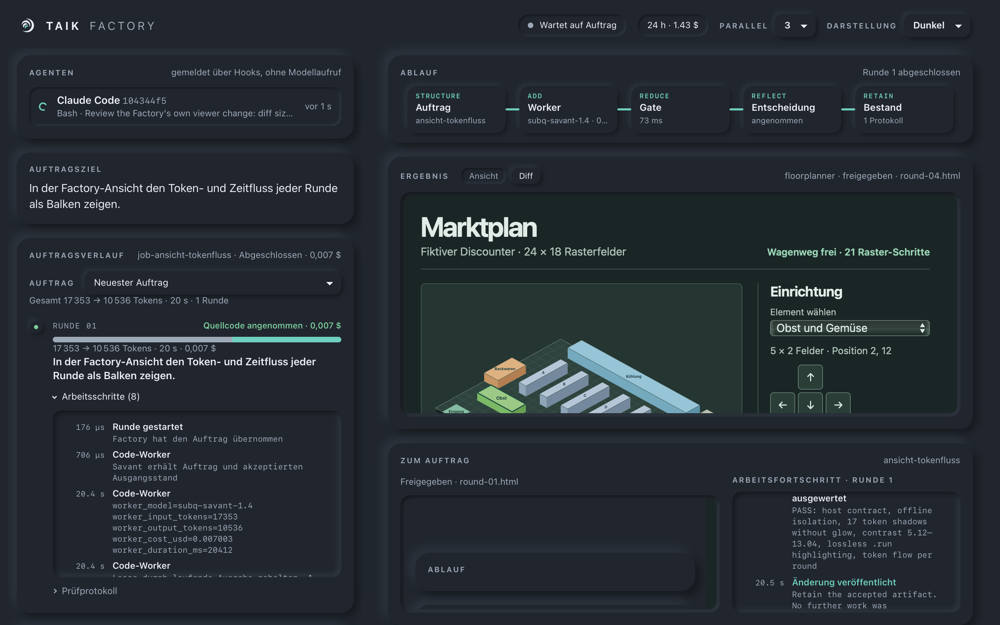

<p align="center"></p>

# TAIK

TAIK is an experiment in a software factory that applies its own creative process to itself. A job states an intent, a worker proposes a candidate, an independent gate judges it, and the decision is kept as a record that later work can build on.

The name is a visual pun on *talk*, as in Smalltalk but not small. It also sounds like the German *Teig*, dough: material that is worked, rests and is worked again. And it is *talk* with the **l** replaced by an **i**, which puts **AI** in the middle. A Teig factory bakes bread.

The specification is [TAIK-FACTORY-SEED-v0.4.md](TAIK-FACTORY-SEED-v0.4.md). It is frozen. [AGENTS.md](AGENTS.md) holds the working rules for agents.

## Status

This is a running seed, not a product. What the evidence supports today:

| Claim | State |
| --- | --- |
| A bounded round runs real work and an independent gate decides it | Shown for tag procedures and for HTML software jobs |
| A rejected candidate leaves the accepted result intact | Shown |
| Accepted work survives a restart and is reused by later rounds | Shown |
| Unattended rounds build software that is not HTML | Shown twice: a Rust tool as one file and as a Cargo project of four files, compiled and run by their gates. See [job-taik-stats](evidence/jobs/job-taik-stats/observation.run) |
| The Factory changes its own viewer without an agent writing the code | Shown once: the service worker patched the installed viewer in six blocks, accepted in round 1. An agent still ran the WebKit check and installed it. See [the observation](evidence/jobs/job-ansicht-tokenfluss/observation.run) |
| The Factory writes its next job itself | Shown once, with the user's approval: brief and gate derived from an observation, accepted in round 1. See [the observation](evidence/jobs/job-mehrdatei-programm/observation.run) |
| The Factory changes its own procedures and viewer through its own gate | Shown for the search procedure and the viewer |
| The Factory judges and installs its own backend | Shown once. The installed binary ran the pinned gate, checked the candidate itself and replaced itself in [job-backend](evidence/jobs/job-backend/round-01.run). The thirteen rounds before were decided by their authors |
| Reusing a result across jobs lowers cost (G-03, I-03) | Not supported on software jobs. See [the experiment](evidence/jobs/job-galaxy-quellcode/summary.run) |
| The seed derives its own learning procedure (I-01) | Not shown. Every learning rule so far was written by an external agent |

[evidence/README.md](evidence/README.md) indexes every job with its brief, gate and decision.

## How a job runs

1. A **brief** states the intent. Its first line names the round.
2. A **gate** is a Node.js script written before the candidate exists. The Factory pins its SHA-256 for the life of the job.
3. A **worker** supplies the candidate. The Factory runs the gate on it in a sandbox without network or write access.
4. The Factory writes a **`.run` record** with the decision, the worker, the gate digest, the checks and the continuation. Records are create-only.
5. A job has at most four source rounds. A rejected candidate with an actionable assertion goes back to the worker with the diagnosis.

A worker holds a lease of 60 s that each piece of its output renews. A worker that stays silent longer ends as `stalled`. No call runs longer than 900 s. A lock on the job keeps a second worker away. When an accepted source exists, the worker may return a patch of SEARCH/REPLACE blocks instead of the whole document. The gate always judges the complete result.

## Build and try

Requires Rust with edition 2024 and a filesystem with hard links. Software jobs need macOS and Node.js.

```sh
cargo build --release --offline --locked
run_dir=$(mktemp -d)
seed=target/release/taik-seed

"$seed" seed "$run_dir/seed.run"
"$seed" reject "$run_dir/seed.run" "$run_dir/rejected.run" || test "$?" -eq 1
"$seed" extend "$run_dir/seed.run" "$run_dir/extended.run" '  ELM ' ' ASH' '  '
"$seed" evolve "$run_dir/extended.run" "$run_dir/evolved.run"
```

The seed domain is a sorted list of unique ASCII tags together with the order of the operations that normalise it. `reject` proposes a deliberately wrong procedure. `evolve` searches one-step reorderings and accepts one only if it preserves the output and reduces measured work.

Exit codes are `0` for acceptance, `1` for an evaluated rejection and `2` for an invocation or file error.

```sh
cargo test --offline --locked
cargo clippy --offline --locked --all-targets -- -D warnings
```

## Software jobs

One attached round, with the candidate on standard input. `NAME` goes into the record as the worker:

```sh
taik-seed source evidence/jobs/job-NAME brief.md verify.mjs --attached=NAME < candidate.html
```

A queued job, worked by the service without supervision:

```sh
taik-seed queue-source STATE NAME brief.md verify.mjs [accepted-source]
```

`STATE` is the service's state directory. The command snapshots brief and gate into `STATE/jobs/job-NAME` and wakes the service.

Unattended rounds need a worker command:

| Variable | Effect |
| --- | --- |
| `TAIK_LEAD_WORKER` | Path to a Claude CLI, which runs first, without tools, as Opus 5.5 at medium effort. Or the word `savant`, which calls Savant 1.4 over the SubQ chat endpoint, streamed and without tools. Codex is not called. |
| `TAIK_SUBQ_KEYCHAIN` | `service/account` of the macOS keychain entry with the SubQ key, used when `SUBQ_API_KEY` is unset. The key appears in no record. |
| `TAIK_SECOND_WORKER` | Path to a Claude CLI that takes over when the Codex worker fails before a gate judgement. |
| neither | The signed-in Codex subscription does the work. |
| `TAIK_DAILY_BUDGET_USD` | Bound on the cost of Claude rounds within 24 hours, at list price. Default 3. A round beyond it is rejected before the worker is called. |

Both workers get the same prompt and the same sandbox. The Claude CLI runs headless as a subprocess (`claude -p`) with the login of the account, without tools. A Claude round records model, output tokens, cost, duration and the usage state the account reported. A failed worker records its stage, kind and duration, never its raw output. Setting either variable lets the service spend usage on your account.

A gate may authorise one follow-up job by starting with `// TAIK: allow-follow-up` and printing one `TAIK_FOLLOWUP: <next intent>` line when it accepts.

## The service

`taik-seed serve STATE` watches `STATE/jobs`, works up to three software jobs side by side (the viewer's setting in `STATE/parallel`, otherwise `TAIK_PARALLEL`, at most eight), each to its final decision, and then blocks on the kernel until the next one arrives. It does not poll. `taik-seed drain STATE` runs the same logic once and exits.

On macOS the service can run under launchd. [tools/service/local.taik.factory.plist](tools/service/local.taik.factory.plist) is a template:

```sh
state="$HOME/.local/state/taik-factory"        # any directory
mkdir -p "$state" && cp target/release/taik-seed "$state/"
ln -s "$PWD/evidence/jobs" "$state/jobs"        # keep records in the checkout
# fill in the template, then:
cp tools/service/local.taik.factory.plist ~/Library/LaunchAgents/
launchctl bootstrap "gui/$(id -u)" ~/Library/LaunchAgents/local.taik.factory.plist
```

The template sets `ProcessType` to `Interactive`. Without it launchd throttled the gate process to between 2.5 and 13.8 s instead of 90 ms.

The service stays a persistent process. It finished tag jobs in 55 to 72 ms. A `drain` started by launchd on demand took 81 to 293 ms. See [the measurement](evidence/jobs/job-dienst-form/summary.run).

## Jobs the Factory proposes

```sh
taik-seed propose STATE NAME evidence/jobs/job-X/round-NN.run
taik-seed approve STATE NAME
```

With `TAIK_AUTO_PROPOSE` set, the service reflects once after each finished software job, at most three times in 24 hours, and either writes a proposal or records why it stops. Waiting proposals appear in the viewer with an approve button.

`propose` asks the worker for a brief and a gate, derived from the continuation of a record. Both wait in `STATE/proposals/NAME`. Nothing runs until `approve` queues the job. The worker that later writes the candidate sees the brief and never the gate.

## Requests from GitHub issues

`tools/issues-sync.sh` reads open issues with the label `taik` that the repository owner wrote. Each becomes a proposal that waits. The label `freigegeben` approves it, the decision of the job is posted back, and an accepted job closes the issue. Without the argument `apply` the script only reports what it would do. Text by anyone else never reaches a worker.

## Changing the backend

The installed binary judges its successor:

```sh
installed="$state/taik-seed"
"$installed" promote evidence/jobs/job-backend brief.md tools/backend/gate.sh "$installed" AUTHOR
```

Only the installed binary may run this. It pins the gate, runs it in the checkout to test and build the candidate, then exercises the candidate with seed, reject and extend checks of its own. On acceptance it keeps candidate and predecessor in the job folder, replaces itself and writes the record. A running service notices the replacement and leaves the next job to its successor.

## The viewer



`./tools/open-factory-view.sh` builds and installs **TAIK Factory.app** into `~/Applications`. The window follows the job with the latest activity and updates on filesystem events. It makes no model calls.

- Left: the goal and the history of the selected job. **Arbeitsschritte** shows the trace of a round, **Prüfprotokoll** its decision record with keys, outcomes, digests, file names and quantities marked.
- Right, top: the published Floorplanner, running in a script-only sandbox without network.
- Right, bottom: the selected job. During a round it renders the draft without scripts above its source, next to the live progress. The Claude worker streams, so the draft grows while it writes.

- Costs: the header shows the worker cost of the last 24 hours, the job list and the history show the cost of each job and round at list price.
- Diff: the result pane can show only the lines that changed against the previously accepted state. The viewer computes it locally.
- Agents: Claude Code sessions in this checkout report each tool call through `tools/agent-hook.sh`, set up in `.claude/settings.json`. The hook writes one small file per session into `STATE/agents`. No model is called for it.

The viewer is `tools/factory-view.html`. It changes only through a source job. Before installing, check a snapshot:

```sh
"$HOME/Applications/TAIK Factory.app/Contents/MacOS/factory-view" --snapshot |
  swift tools/check-factory-design.swift --require-open
```

## What has been measured

| Observation | Result | Evidence |
| --- | --- | --- |
| Reordering the tag procedure | 14 to 9 bytes sent to lowercasing, 4 to 3 items sorted, same output | [job-tag-prozedur](evidence/jobs/job-tag-prozedur/08-local-reduce.run) |
| Time to the first result with 2000 archived jobs | 239.8 ms to 50.2 ms, median of 8 | [round 9](evidence/jobs/job-rust-entrypoint/round-09.run) |
| Unattended round without a working worker | rejected, then accepted after a second worker was configured | [before](evidence/jobs/job-worker-verfuegbarkeit/round-01.run), [after](evidence/jobs/job-worker-verfuegbarkeit-2/round-01.run) |
| Six software jobs queued at once, three slots | done after 249 s against 575 s of worker time in sum, all accepted in round 1 | [summary](evidence/jobs/job-dienst-durchsatz/summary.run) |
| Gate process under launchd | 2.5 to 13.8 s with the default process type, 75 to 90 ms with `Interactive`, four runs each | [summary](evidence/jobs/job-dienst-drosselung/summary.run) |
| Savant against Opus as the worker, same briefs and gates | both accepted in round 1 on two jobs. Savant took 10 s and 40 s at 0.003 and 0.010 USD, Opus 24 s and 67 s at 0.075 and 0.150 USD list price | [summary](evidence/jobs/job-savant-worker/summary.run) |
| Snap as a classifier of rejected rounds | 6 of 6 matched the expected cause, labels not independent | [summary](evidence/jobs/job-snap-kategorisierer/summary.run) |
| Reuse of an accepted operator in another software job | no benefit: 0.122 against 0.100 USD mean, all four runs accepted in round 1 | [summary](evidence/jobs/job-galaxy-quellcode/summary.run) |
| Successor job from scratch against building on the accepted source | all three reuse runs accepted in round 1, one of three scratch runs needed four rounds. Means 0.011 against 0.022 USD, medians equal | [summary](evidence/jobs/job-galaxy-quellcode/summary-02.run) |
| Reuse including setup on tag batches | slower than both comparators at that sample size | [summary](evidence/jobs/job-galaxy-intelligence/summary.run) |

## Limits

- macOS only for software jobs, the service template and the viewer. The Linux watcher is untested.
- Records and gates are trusted local files. Power-loss recovery is untested.
- Accepted backend binaries are not in this repository. Each record carries the SHA-256 of its binary.
- Records contain absolute paths of the machine they were written on.
- Most jobs so far changed the Factory itself. Capability growth in the sense of section 2.5 of the specification is not shown.

## Commands

```text
taik-seed seed OUTPUT.run
taik-seed extend BASELINE.run OUTPUT.run TAG [TAG ...]
taik-seed reject|refine BASELINE.run OUTPUT.run
taik-seed evolve BASELINE.run OUTPUT.run
taik-seed evaluate BASELINE.run OUTPUT.run ORDER
taik-seed source JOB BRIEF GATE [--attached[=WORKER]]
taik-seed promote JOB BRIEF GATE INSTALLED_BINARY WORKER
taik-seed propose STATE NAME RECORD.run
taik-seed approve STATE NAME
taik-seed experiment BASELINE.run OUTPUT_DIRECTORY
taik-seed queue STATE BASELINE.run
taik-seed queue-source STATE NAME BRIEF GATE [ACCEPTED_SOURCE]
taik-seed queue-self STATE
taik-seed drain|serve STATE
taik-seed serve STATE --reflect
```

## License

[MIT](LICENSE)
